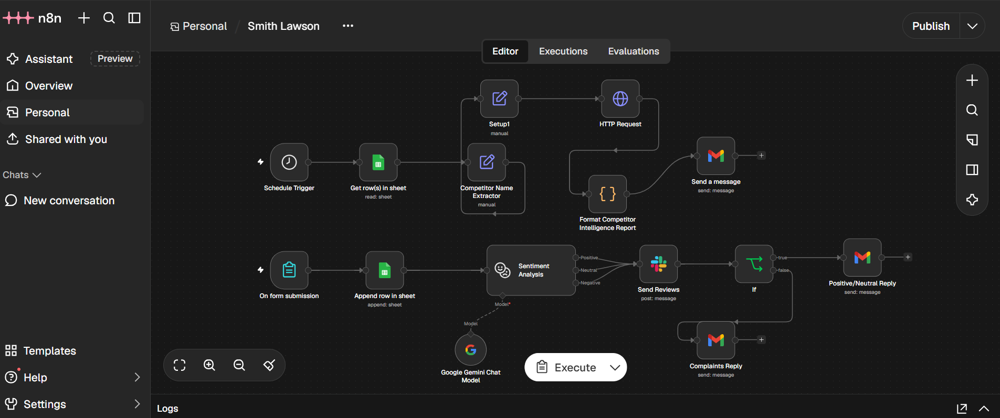

# Smith Lawson PLC — AI-Powered Competitor Intelligence & Feedback Automation

## Project Overview
An independent n8n automation case study for a fictional alcoholic beverage company. The solution combines competitor intelligence reporting with AI-assisted customer feedback handling.

## Business Problem
Manual competitor monitoring takes time, while incoming customer feedback may be difficult to categorise and route consistently. The objective was to demonstrate how automated workflows could support market awareness and timely responses.

## Solution Architecture

### Workflow A — Competitor Intelligence
1. A scheduled trigger initiates the process.
2. Google Sheets provides competitor information.
3. An HTTP request retrieves relevant news data from an external API.
4. A formatting step prepares the intelligence report.
5. Gmail delivers the report.

### Workflow B — Customer Feedback Handling
1. A form submission triggers the workflow.
2. Google Sheets records the submission.
3. A Google Gemini-powered step analyses sentiment.
4. Slack receives a feedback notification.
5. Conditional logic routes feedback to positive/neutral or complaint-response paths in Gmail.

## Technology Stack
- n8n — workflow orchestration
- Google Sheets — data storage and retrieval
- HTTP Request / NewsAPI — competitor news retrieval
- Google Gemini — sentiment analysis
- Slack — team notifications
- Gmail — automated email communication

## Skills Demonstrated
- Workflow orchestration and conditional logic
- Third-party API integration
- AI-assisted sentiment analysis
- Automated reporting and notifications
- Multi-step business process automation
## Workflow Architecture

## Project Scope
This is a simulated business case study, not a deployment for the real company. The workflows were developed and tested in a learning environment. No production business impact or performance metrics are claimed.

## Demonstration
Video demonstration: To be added.

## Author
Abass John Bangura — AI Automation Engineering Portfolio
